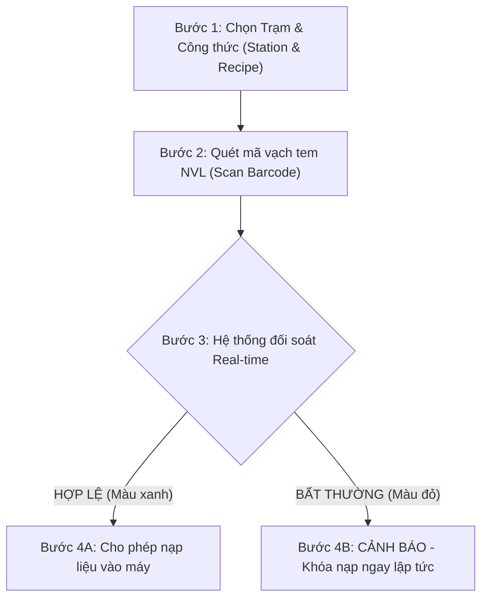

# CẨM NANG HƯỚNG DẪN SỬ DỤNG KDMES TOOL (PHIÊN BẢN v2.3.76+)
## ĐỢT 1: CÁC PHÂN HỆ VẬN HÀNH CỐT LÕI HÀNG NGÀY

Tài liệu này được biên soạn chuẩn hóa theo quy trình vận hành sản xuất thực tế tại nhà máy Kenda và dữ liệu kiến trúc hệ thống từ **Graphify Knowledge Graph**. Bắt buộc toàn bộ nhân sự vận hành (Kho, QC, Kỹ thuật, Tổ trưởng sản xuất và IT MES) tuân thủ đúng quy trình.

---

# MỤC LỤC
1. [Phân Hệ 1: Main Dashboard & Tra Cứu Toàn Năng](#1-main-dashboard--tra-cứu-toàn-năng)
   - [1.1. Mục đích & Phạm vi](#11-mục-đích--phạm-vi)
   - [1.2. Hướng dẫn tra cứu (Nhập mã & Quét ảnh OCR)](#12-hướng-dẫn-tra-cứu-nhập-mã--quét-ảnh-ocr)
   - [1.3. Cẩm nang 8 tính năng Context Menu (Chuột phải)](#13-cẩm-nang-8-tính-năng-context-menu-chuột-phải)
   - [1.4. Lọc dữ liệu & Xuất báo cáo Excel](#14-lọc-dữ-liệu--xuất-báo-cáo-excel)
2. [Phân Hệ 2: Tem Vận Chuyển (Material Transfer)](#2-phân-hệ-2-tem-vận-chuyển-material-transfer)
   - [2.1. Mục đích](#21-mục-đích)
   - [2.2. Tra cứu lịch sử chuyển kho](#22-tra-cứu-lịch-sử-chuyển-kho)
   - [2.3. Kiểm tra tem lỗi chuyển kho (Check Failed Transfer)](#23-kiểm-tra-tem-lỗi-chuyển-kho-check-failed-transfer)
   - [2.4. Chuyển đổi môi trường cơ sở dữ liệu KV1 và KV2](#24-chuyển-đổi-môi-trường-cơ-sở-dữ-liệu-kv1-và-kv2)
3. [Phân Hệ 3: Kiểm Tra Cấp Liệu (Validate Scan Barcode)](#3-phân-hệ-3-kiểm-tra-cấp-liệu-validate-scan-barcode)
   - [3.1. Mục đích Poka-Yoke (Chống sai lỗi)](#31-mục-đích-poka-yoke-chống-sai-lỗi)
   - [3.2. Quy trình quét xác thực 4 bước tại trạm cân/trộn](#32-quy-trình-quét-xác-thực-4-bước-tại-trạm-cântrộn)
   - [3.3. Các trạng thái cảnh báo & Cách xử lý](#33-các-trạng-thái-cảnh-báo--cách-xử-lý)
4. [Phân Hệ 4: Truy Vấn In Bù (Reprint Label)](#4-phân-hệ-4-truy-vấn-in-bù-reprint-label)
   - [4.1. Mục đích & Điều kiện áp dụng](#41-mục-đích--điều-kiện-áp-dụng)
   - [4.2. Quy trình in bù tem 5 bước chuẩn](#42-quy-trình-in-bù-tem-5-bước-chuẩn)
   - [4.3. Quản lý thiết bị máy in mã vạch (Zebra, TSC)](#43-quản-lý-thiết-bị-máy-in-mã-vạch-zebra-tsc)
5. [Bảng Tra Cứu Nhanh Sự Cố Thường Gặp (Troubleshooting)](#5-bảng-tra-cứu-nhanh-sự-cố-thường-gặp-troubleshooting)

---

## 1. MAIN DASHBOARD & TRA CỨU TOÀN NĂNG

### 1.1. Mục đích & Phạm vi
Màn hình **Main** (`/main`) là trung tâm điều khiển và tra cứu hợp nhất của toàn bộ hệ thống KDMES. Cho phép người dùng truy vết toàn bộ vòng đời sản phẩm: từ nguồn gốc nguyên vật liệu thô (Raw Rubber/Chemicals), bán thành phẩm (Tread, Sidewall, Ply, Bead...), đến đơn điều động sản xuất MES (Work Order) và thành phẩm lốp xe.

### 1.2. Hướng dẫn tra cứu (Nhập mã & Quét ảnh OCR)
- **Cách 1: Nhập mã trực tiếp**:
  1. Chọn loại đối tượng cần tìm tại thanh Dropdown (Mặc định: `Barcode`). Các đối tượng hỗ trợ: `Barcode`, `Recipe`, `Work Order`, `Station`, `Material`.
  2. Nhập hoặc dùng máy quét bắn mã vào ô tìm kiếm.
  3. Nhấn **Enter** hoặc click biểu tượng Kính lúp. Dữ liệu sẽ trả về tại bảng Output trong vòng dưới 0.5 giây.
- **Cách 2: Nhận dạng qua ảnh Barcode (Image to Text OCR)**:
  1. Click vào khung **"Image to Text"** hoặc bấm phím tắt `Ctrl + V` khi đã sao chép ảnh chụp tem từ máy tính/điện thoại.
  2. Bạn cũng có thể kéo thả tệp ảnh (`.png`, `.jpg`, `.jpeg`) trực tiếp vào vùng tải ảnh.
  3. Hệ thống ứng dụng công cụ OCR chuyên sâu nhận diện tức thời chuỗi Barcode và tự động kích hoạt tra cứu.

### 1.3. Cẩm nang 8 tính năng Context Menu (Chuột phải)
Khi bảng hiển thị dữ liệu dòng tem, nhấp **chuột phải** vào bất kỳ dòng nào để mở menu tính năng nâng cao:

| Tên Chức Năng | Ý Nghĩa Nghiệp Vụ | Thao Tác & Kết Quả |
| :--- | :--- | :--- |
| **Xem tem cùng MES** *(Mới)* | Tìm toàn bộ các tem vật tư/BTP được sản xuất **chung một đơn điều động (Work Order)** với tem đang chọn. | Click vào mục này $\rightarrow$ Hệ thống gọi API truy vấn tối ưu và hiển thị danh sách các tem cùng mẻ/đơn tại bảng. *(Lưu ý: Menu chuột phải sẽ được tạm khóa khi đang xem để tránh click lặp).* |
| **MES Tracking** | Truy xuất hành trình luân chuyển chi tiết của tem qua từng công đoạn. | Xem thời gian tạo tem, người tạo, trạm sản xuất, thời gian nhập/xuất kho và trạng thái đồng bộ ERP. |
| **Xem đơn điều động** | Xem thông tin chi tiết lệnh sản xuất (Work Order) điều phối tem này. | Trả về thông tin: Mã công thức (`recipe_id`), Trạm máy (`station`), Ngày điều động (`reserved_date`), Số lượng mẻ kế hoạch và trạng thái. |
| **Xem tem đầu ra** | Xem danh sách các tem thành phẩm/BTP được tạo ra từ tem nguyên liệu này. | Hệ thống sử dụng thuật toán `DISTINCT` khử trùng lặp nhiều lần cấp liệu, hiển thị danh sách tem đầu ra chính xác 100%. |
| **Kiểm tra tiêu thụ tem** | Báo cáo chi tiết sản lượng tiêu hao thực tế của tem trong các mẻ sản xuất. | Cung cấp: Tổng lượng tiêu hao (`total_consumption`), tỷ lệ tiêu hao (`consumption`), số lượng tem đầu ra (`total_barcode`), vị trí khay/site đang nạp (`Đang bind` / `Đã unbind`). |
| **Kiểm tra Commit GitLab** *(Dành cho Recipe)* | Đối chiếu lịch sử chỉnh sửa file công thức sản xuất trên hệ thống GitLab CE Kenda. | So sánh diff giữa các phiên bản YAML, kiểm tra ai sửa, sửa lúc nào và trạng thái kiểm tra tự động Pipeline (Passed/Failed). |
| **Xem nội dung YAML** | Xem trực tiếp mã nguồn cấu hình công thức cấp liệu của Recipe. | Kiểm tra tính chuẩn xác của thụt lề (2 khoảng trắng), thứ tự hóa chất, trọng lượng cài đặt. |
| **In lại tem (Reprint)** | Kích hoạt in lại tem vật tư này ra máy in mã vạch. | Mở hộp thoại chọn máy in đích, nhập lý do in bù và gửi lệnh in tức thời. |

### 1.4. Lọc dữ liệu & Xuất báo cáo Excel
- **Tìm kiếm nhanh trong bảng**: Sử dụng ô lọc nhanh ở đầu mỗi cột để lọc theo ký tự (không phân biệt hoa thường).
- **Xuất dữ liệu Excel**: Click nút **"Export to Excel"** ở góc phải bảng. Hệ thống tự động trích xuất toàn bộ dữ liệu đang hiển thị ra file `.xlsx` định dạng chuẩn.

---

## 2. PHÂN HỆ 2: TEM VẬN CHUYỂN (MATERIAL TRANSFER)

### 2.1. Mục đích
Hỗ trợ thủ kho, nhân viên logistics và điều độ sản xuất tra cứu, kiểm soát việc điều chuyển nguyên vật liệu giữa các kho trung gian, kho hỗn luyện và xưởng thành phẩm thuộc **Xưởng 1 (KV1)** và **Xưởng 2 (KV2)**.

### 2.2. Tra cứu lịch sử chuyển kho
1. Truy cập menu **"Xử lý Tem & NVL"** $\rightarrow$ **"Tem vận chuyển"** (`/material-transfer`).
2. Nhập mã Barcode vật liệu cần tra cứu (hoặc dán ảnh OCR).
3. Bảng kết quả hiển thị lịch sử:
   - **Kho xuất (Source Location)**: Nơi tem xuất phát.
   - **Kho đến (Destination Location)**: Vị trí đích cần chuyển tới.
   - **Thời gian xuất / nhập**: Thời điểm phát sinh giao dịch.
   - **Người thực hiện**: User MES phụ trách quét chuyển.
   - **Trạng thái**: Đã nhận, Đang trên đường chuyển, hoặc Chuyển lỗi.

### 2.3. Kiểm tra tem lỗi chuyển kho (Check Failed Transfer)
- Nhấn nút **"Check Failed Transfer"** màu xanh ngọc ở góc trên cùng bên trái.
- Hệ thống tự động quét và lọc ra toàn bộ các kiện hàng/tem phát sinh lỗi trong quá trình luân chuyển (ví dụ: kho xuất đã quét đi nhưng kho nhận chưa nhận sau 24h, hoặc lỗi gián đoạn đồng bộ MES-ERP).
- Giúp thủ kho kịp thời xử lý hàng tồn đọng hoặc kiểm kê hàng thất lạc.

### 2.4. Chuyển đổi môi trường cơ sở dữ liệu KV1 và KV2
- Tại thanh công cụ chân trang (Sidebar Footer) hoặc góc màn hình: Sử dụng nút chuyển đổi môi trường **[ KV1 | KV2 | DEV ]**.
  - **KV2 (Mặc định)**: Kết nối CSDL Xưởng 2 (`198.1.10.85:5432`).
  - **KV1**: Kết nối CSDL Xưởng 1 (`198.1.1.92:5432`).
  - **DEV**: Môi trường kiểm thử nội bộ IT (`198.1.10.3:5432`).
- Khi chuyển sang **KV1**, toàn bộ API tra cứu chuyển kho và danh sách lỗi sẽ tự động chuyển sang đọc dữ liệu từ máy chủ KV1 với thông báo Toast trực quan.

---

## 3. PHÂN HỆ 3: KIỂM TRA CẤP LIỆU (VALIDATE SCAN BARCODE)

### 3.1. Mục đích Poka-Yoke (Chống sai lỗi)
Đây là chốt chặn an toàn chất lượng cực kỳ quan trọng tại các trạm cân cao su, cân hóa chất, máy trộn kín (Banbury Mixer) và máy ép đùn. Hệ thống đóng vai trò "người gác cổng" ngăn ngừa 100% rủi ro:
- Cấp sai mã vật tư so với công thức (Recipe) đã phê duyệt.
- Cấp vật tư đã hết hạn sử dụng (Expired Material).
- Cấp vật tư chưa đủ thời gian ổn định công nghệ (Chưa đủ Standing Time).
- Cấp vật tư đang trong tình trạng bị khóa kiểm định (QC Hold / Status != 1).

### 3.2. Quy trình quét xác thực 4 bước tại trạm cân/trộn

1. **Bước 1**: Chọn **Trạm máy (Station)** đang thao tác và **Mã công thức (Recipe ID)** chuẩn bị sản xuất.
2. **Bước 2**: Công nhân sử dụng máy quét cầm tay bắn mã Barcode dán trên bao/kiện cao su hoặc thùng hóa chất.
3. **Bước 3**: Màn hình hệ thống phản hồi tức thì với 2 kịch bản:
   - **TRƯỜNG HỢP HỢP LỆ (Giao diện hiển thị viền XANH LÁ + Âm thanh xác nhận)**:
     - Tên vật tư khớp với danh mục BOM của Recipe.
     - Hạn dùng còn hiệu lực.
     - Tem ở trạng thái sẵn sàng (`status = 1`).
   - **TRƯỜNG HỢP BẤT THƯỜNG (Giao diện chớp ĐỎ + Âm thanh cảnh báo lỗi)**:
     - Xuất hiện thông báo lỗi chi tiết lý do (Ví dụ: *"Vật tư không thuộc công thức"*, *"Tem đã hết hạn từ ngày..."*, *"Trạng thái tem đang bị QC khóa"*).
4. **Bước 4**: Nếu cảnh báo đỏ, công nhân **TUYỆT ĐỐI KHÔNG ĐƯỢC ĐỔ VẬT LIỆU VÀO MÁY**, cách ly kiện hàng và báo ngay cho Tổ trưởng hoặc Kỹ thuật trực ca.

---

## 4. PHÂN HỆ 4: TRUY VẤN IN BÙ (REPRINT LABEL)

### 4.1. Mục đích & Điều kiện áp dụng
Áp dụng khi tem vật tư bị rách nát, nhòe mực, dính bẩn không quét được bằng đầu đọc laser, hoặc trường hợp cần chia nhỏ khối lượng/tách kiện theo yêu cầu công nghệ.

### 4.2. Quy trình in bù tem 5 bước chuẩn
1. **Bước 1: Truy cập màn hình in bù**: Vào menu **"Xử lý Tem & NVL"** $\rightarrow$ **"Truy vấn in bù"** (`/reprint`).
2. **Bước 2: Tìm kiếm tem gốc**: Nhập chuỗi Barcode gốc hoặc quét mã còn sót lại.
3. **Bước 3: Kiểm tra thông số tem trước khi in**:
   - Đối chiếu kỹ: Mã sản phẩm (`product_id`), Số lượng còn lại (`quantity`), Số lô (`lot_number`), Hạn sử dụng (`expiry_time`).
4. **Bước 4: Thiết lập lệnh in**:
   - Nhấp chọn chức năng **In lại tem**.
   - Chọn **Máy in đích** (Danh sách các máy in mã vạch Zebra ZT410, TSC TTP-244 Pro được cấu hình theo trạm).
   - Chọn **Lý do in bù**: `0 - Tem hỏng/rách`, `1 - Chia nhỏ kiện`, `2 - In bù theo lệnh kỹ thuật`.
5. **Bước 5: Xác nhận in**:
   - Nhấn **Xác nhận In**. Lệnh in được đẩy trực tiếp qua cổng mạng RAW socket đến máy in tem.
   - Nhận tem mới, dán đè lên kiện hàng và hủy bỏ tem hỏng cũ.

### 4.3. Quản lý thiết bị máy in mã vạch (Zebra, TSC)
- Nếu máy in tại trạm bị kẹt giấy, hết ruy-băng mực hoặc báo lỗi kết nối:
  - Sử dụng công cụ **Switching Spell** trong menu **Elder Wand** để tạm thời chuyển hướng luồng in sang máy in của trạm kế bên.

---

## 5. BẢNG TRA CỨU NHANH SỰ CỐ THƯỜNG GẶP (TROUBLESHOOTING)

| Hiện Tượng / Thông Báo Lỗi | Nguyên Nhân Thường Gặp | Cách Xử Lý Nhanh |
| :--- | :--- | :--- |
| **"Không tìm thấy tem đầu ra nào"** | Tem nguyên liệu chưa tham gia vào mẻ sản xuất nào đã hoàn thành (`status = 2`). | Kiểm tra lại mẻ trộn trong menu *Kiểm tra tiêu thụ tem* xem mẻ đang trộn hay đã xong. |
| **"Lỗi kết nối máy chủ KV1 / KV2"** | Mạng nội bộ phân xưởng bị chập chờn hoặc địa chỉ IP cơ sở dữ liệu thay đổi. | Kiểm tra biểu tượng mạng, thử chuyển đổi qua lại giữa KV1/KV2 hoặc liên hệ IT nội bộ (số nội bộ: 198). |
| **"Vật tư chưa đủ thời gian ổn định (Standing Time)"** | Cao su sau khi luyện cần tối thiểu 2 đến 4 giờ ổn định nhiệt độ trước khi chuyển công đoạn sau. | Đưa kiện cao su vào khu vực chờ (Standing Area) đến khi đồng hồ đếm ngược kết thúc. |
| **"Tem đang bị khóa (QC Hold)"** | Bán thành phẩm có chỉ số kiểm định chưa đạt chuẩn, phòng QC đang tạm giữ để thẩm định. | Liên hệ nhân viên QC phụ trách ca để kiểm tra kết quả thí nghiệm trước khi xin phê duyệt đặc biệt. |
| **"Máy in không phản hồi lệnh in bù"** | Máy in bị offline, đứt dây mạng LAN hoặc sai địa chỉ IP gán trong cấu hình trạm. | Kiểm tra đèn tín hiệu máy in (Đèn xanh = Ready, Đèn đỏ = Paper/Ribbon Out). Mở *Thiết lập máy* để kiểm tra IP máy in. |
